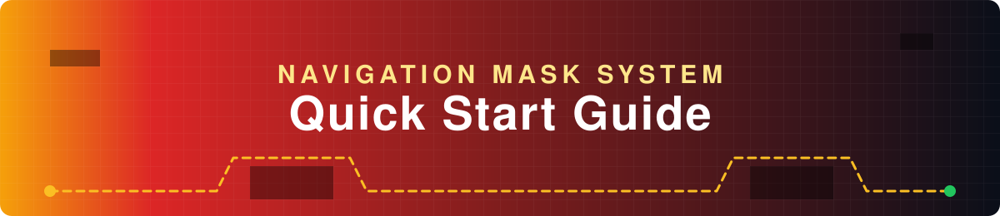

<!-- markdownlint-disable MD033 MD041 MD026 -->
<div align="center">



<a href="https://github.com/heyaftab/python-red-alert">
  
</a>

<br/>

<p>
  <b>Your game now has a complete navigation and collision detection system.</b><br/>
  Four steps to intelligent pathfinding that avoids every terrain obstacle.
</p>

<p>
  
  
  
  
</p>

<p>
  <a href="#-whats-inside"><kbd> 🎁 What's Inside </kbd></a>
  <a href="#-quick-integration"><kbd> ⚡ Integrate </kbd></a>
  <a href="#-key-numbers"><kbd> 📊 Numbers </kbd></a>
  <a href="#-debugging--testing"><kbd> 🧪 Test </kbd></a>
  <a href="#-api-cheat-sheet"><kbd> 📘 Cheat Sheet </kbd></a>
  <a href="#-troubleshooting"><kbd> 🛠️ Fix It </kbd></a>
</p>

</div>


## 🎁 What's Inside

### 🧱 Core Files

| File | What it does | Size |
| :--- | :--- | :---: |
| 🎨 **`nav_mask.py`** | Generates the collision map from the map image | 6.7K |
| 🧭 **`pathfinding.py`** | A* pathfinding algorithm and the API for unit movement | 7.8K |
| 🧊 **`nav_mask.pkl`** | Binary collision map data | 4.1K |
| 🖼️ **`nav_mask_vis.png`** | Visual representation of the collision map | n/a |

### 🧰 Utilities & Documentation

| File | What it does | Size |
| :--- | :--- | :---: |
| 🐞 **`pathfinding_debug.py`** | Debug visualization tools | 9.4K |
| 📘 **`pathfinding_example.py`** | Usage examples and integration code | n/a |
| 🗺️ **`collision_test.png`** | Collision map overlaid on the original map | n/a |
| 📖 **`NAVIGATION_SYSTEM.md`** | Comprehensive documentation | 6.1K |


## ⚡ Quick Integration

<table>
  <tr>
    <td align="center" width="25%"><b>1️⃣ Import</b></td>
    <td align="center" width="25%"><b>2️⃣ Initialize</b></td>
    <td align="center" width="25%"><b>3️⃣ Find path</b></td>
    <td align="center" width="25%"><b>4️⃣ Move units</b></td>
  </tr>
</table>

### 1️⃣ Add to the top of `main.py`

```python
from pathfinding import initialize_pathfinder, find_path, get_pathfinder
```

### 2️⃣ In game initialization

```python
pathfinder = initialize_pathfinder()
```

### 3️⃣ For unit pathfinding

```python
# When unit needs to move to a target
path = find_path(unit.x, unit.y, target_x, target_y)
if path:
    unit.set_path(path)
    unit.path_index = 0
```

### 4️⃣ Update unit position each frame

```python
if unit.path and unit.path_index < len(unit.path):
    next_waypoint = unit.path[unit.path_index]

    # Move towards waypoint
    dx = next_waypoint[0] - unit.x
    dy = next_waypoint[1] - unit.y
    distance = (dx**2 + dy**2) ** 0.5

    if distance < unit.speed * dt:
        unit.path_index += 1  # Move to next waypoint
    else:
        # Normalize and move
        unit.x += (dx / distance) * unit.speed * dt
        unit.y += (dy / distance) * unit.speed * dt
```


## 📊 Key Numbers

<div align="center">

| 🗺️ Map size | 🧱 Tile grid | 🟥 Blocked | 🟩 Walkable | 🪶 Collision map |
| :---: | :---: | :---: | :---: | :---: |
| **1688×932 px** | **85×47** (20px/tile) | **83** (2.1%) | **3912** (97.9%) | **4.1K** |


</div>

## 🔍 What Gets Detected

| Terrain | Result |
| :--- | :--- |
| ✅ **Orange / Brown cliffs** | 🟥 **Blocked** (can't walk) |
| ✅ **Green grass** | 🟩 **Walkable** |
| ✅ **Sandy / tan ground** | 🟩 **Walkable** |
| ❌ **Buildings** | ⚠️ Not in map analysis. Use a separate collision system |

## 📁 Files Generated

| # | File | Contents |
| :---: | :--- | :--- |
| 1 | 🧊 **`nav_mask.pkl`** | Binary collision data for pathfinding |
| 2 | 🖼️ **`nav_mask_vis.png`** | Green (walkable) and red (blocked) visualization |
| 3 | 🗺️ **`collision_test.png`** | Original map with a red overlay on blocked areas |


## 🧪 Debugging & Testing

<table>
  <tr>
    <td width="33%" valign="top">
      <h3>📈 Check statistics</h3>

```bash
python3 pathfinding_debug.py
```

</td>
    <td width="33%" valign="top">
      <h3>👀 View the collision map</h3>
      Open <code>nav_mask_vis.png</code> or <code>collision_test.png</code> to verify terrain detection.
    </td>
    <td width="33%" valign="top">
      <h3>🧭 Test pathfinding</h3>

```bash
python3 pathfinding_example.py
```

</td>
  </tr>
</table>


## 📘 API Cheat Sheet

<details open>
<summary><b>Everything you need in one block</b></summary>

<br/>

```python
from pathfinding import initialize_pathfinder, find_path, get_pathfinder
from nav_mask import is_walkable, load_nav_mask

# Initialize
pf = initialize_pathfinder()

# Find paths
path = find_path(x1, y1, x2, y2)  # Returns list of (x,y) waypoints or None

# Coordinate conversion
tx, ty = pf.pixel_to_tile(px, py)
px, py = pf.tile_to_pixel_center(tx, ty)

# Collision checking
blocked = pf.is_tile_blocked(tx, ty)
valid_pos = pf.get_nearest_walkable_point(x, y)

# Direct mask access
nav_mask = load_nav_mask("nav_mask.pkl")
walkable = is_walkable(nav_mask, tx, ty)
```

</details>


## 🛠️ Troubleshooting

<details>
<summary><b>🪨 Units get stuck in terrain</b></summary>

<br/>

- Ensure pathfinding is initialized before units move
- Check that `nav_mask.pkl` exists and is valid
- Verify tile coordinates are within bounds (0-84 for x, 0-46 for y)

</details>

<details>
<summary><b>🚫 No path found</b></summary>

<br/>

- Check the destination is walkable: `is_walkable(nav_mask, goal_tx, goal_ty)`
- Use `get_nearest_walkable_point()` to find a valid destination
- Ensure start and goal aren't in isolated regions

</details>

<details>
<summary><b>🎨 Wrong obstacles detected</b></summary>

<br/>

- Modify the color thresholds in the `get_color_category()` function in `nav_mask.py`
- Regenerate with: `python3 nav_mask.py`

</details>

## ⚡ Performance

<table>
  <tr>
    <td width="25%" align="center" valign="top">
      <h2>🧭</h2>
      <b>Pathfinding</b><br/><br/>
      ~0.5-2ms for typical paths
    </td>
    <td width="25%" align="center" valign="top">
      <h2>💨</h2>
      <b>Cached paths</b><br/><br/>
      &lt;0.1ms (instant)
    </td>
    <td width="25%" align="center" valign="top">
      <h2>🪶</h2>
      <b>Memory</b><br/><br/>
      4.1KB for the entire map
    </td>
    <td width="25%" align="center" valign="top">
      <h2>🧱</h2>
      <b>Grid</b><br/><br/>
      85×47 tiles is very fast
    </td>
  </tr>
</table>


## 🚀 Next Steps

| Step | Action |
| :---: | :--- |
| **1** | 📋 Copy the integration code into your `main.py` |
| **2** | 🧪 Test with `python3 pathfinding_example.py` |
| **3** | 📖 Use [`NAVIGATION_SYSTEM.md`](NAVIGATION_SYSTEM.md) for the full API reference |
| **4** | 🐞 Debug with `pathfinding_debug.py` if needed |

<div align="center">

<br/>

### 🎉 That's it! Your units now have intelligent pathfinding that avoids all terrain obstacles.

<br/>


</div>
