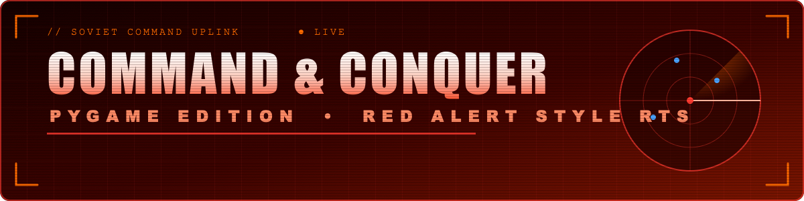
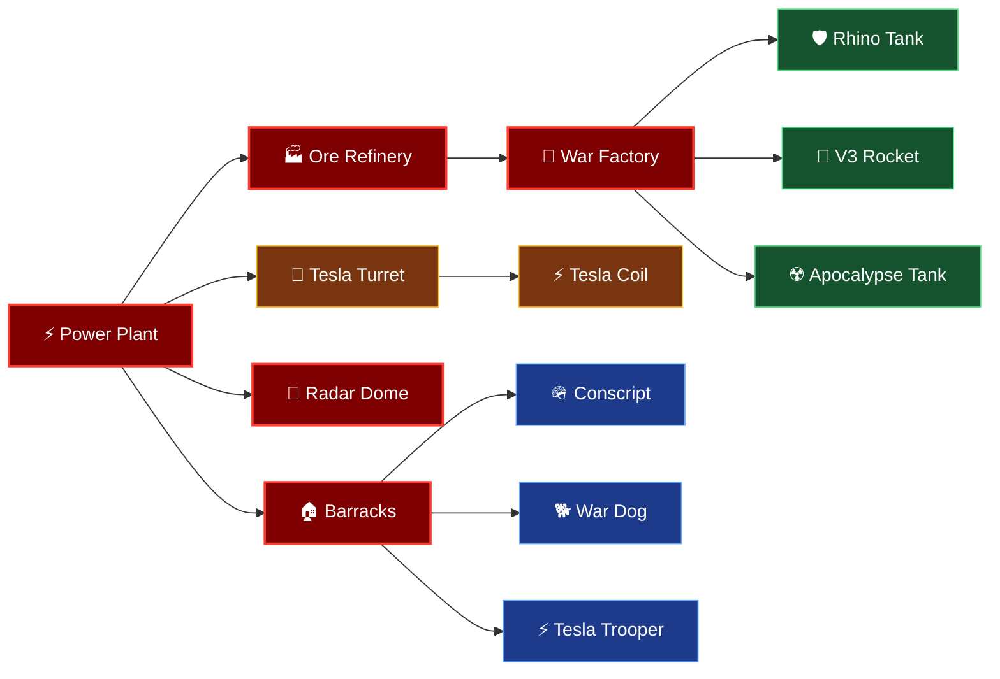
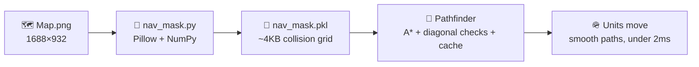

<div align="center">



**Build your base. Harvest the ore. Train your army. Crush the Allies.**

<br/>


<br/>

**[▶ Play in Browser](#-free-web-deployment)** &nbsp;•&nbsp; **[⚡ Features](#-why-its-better)** &nbsp;•&nbsp; **[🕹 Controls](#%EF%B8%8F-tactical-controls)** &nbsp;•&nbsp; **[🌳 Tech Tree](#-the-tech-tree)** &nbsp;•&nbsp; **[📂 Layout](#-codebase-layout)**

</div>


## 🎖️ Mission Briefing

> *"Commander, the Allies are mobilizing. Build. Harvest. Conquer."*

**Command & Conquer: Pygame Edition** is a retro real-time strategy game built with **Python** and **Pygame**. It recreates the gameplay, atmosphere and mechanics of the classic *Red Alert* series: base building, ore harvesting, unit production, combat, and nostalgic voice cues.

You lead the **☭ Soviet Faction (Team Red)** against the **★ Allied Forces (Team Blue)**.

<table>
<tr>
<td width="25%" align="center">🏗️<br/><b>1. Establish a Base</b><br/><sub>Power Plants, Barracks, War Factories, Tesla defenses</sub></td>
<td width="25%" align="center">💰<br/><b>2. Manage Economy</b><br/><sub>Harvest gold ore, feed the refinery, keep the grid powered</sub></td>
<td width="25%" align="center">🪖<br/><b>3. Mobilize Armies</b><br/><sub>Infantry and armored divisions, from Conscripts to Apocalypse Tanks</sub></td>
<td width="25%" align="center">💥<br/><b>4. Destroy the Enemy</b><br/><sub>Survive Allied waves and wipe out their Construction Yard</sub></td>
</tr>
</table>

---

## 🌳 The Tech Tree



---

## 🚀 Free Web Deployment

Host the game **for free** on GitHub Pages. The included GitHub Actions workflow builds the Pygame game for the browser with **Pygbag**. The separate `hero.html` page is a prototype and is *not* the game entry point.

| Step | Action |
|:---:|:---|
| **1** | Push the project to the `main` branch of a **public** GitHub repository. Include the updated root `main.py` and the `.ogg` files in `Sounds/`. The workflow packages the root `assets/` and those OGG sounds, so there is no need to commit generated build output or a second copy of the assets. |
| **2** | Open **Settings → Pages** and select **GitHub Actions** as the build and deployment source. |
| **3** | Push a commit to `main`, or run **Deploy game to GitHub Pages** from the **Actions** tab. |
| **4** | When the workflow succeeds, open `https://<owner>.github.io/<repository>/` |

> [!NOTE]
> The first load downloads the browser runtime and game assets, so it may take a little while. To build locally, install Python 3.12, Pygbag 0.9.3 and Pygame Community Edition; the workflow file contains the exact build options. GitHub Pages is free for public repositories.

---

## ⚡ Why It's Better

### 🧭 Intelligent Hybrid Pathfinding (A\* + Navigation Mask)



- **Pixel-color classification** in [`nav_mask.py`](nav_mask.py) separates green/sandy ground from orange/brown cliff walls.
- High-resolution map assets compile into a compact **4KB binary collision grid** ([`nav_mask.pkl`](nav_mask.pkl)).
- The custom `Pathfinder` class in [`pathfinding.py`](pathfinding.py) runs **A\*** with diagonal checks and a path cache, giving smooth paths under 2ms.

### 🧱 Dynamic Obstacle Registration

Obstacles are not just static cliffs. When you or the AI place structures, the pathfinder updates the tile walkability matrix, so units **detour around buildings in real time**.

### 🔊 Immersive Retro Sound Design

> 🎙️ *"Yes, Commander."* &nbsp;•&nbsp; *"Moving out."* &nbsp;•&nbsp; *"Affirmative."* &nbsp;•&nbsp; 🚨 *"Our base is in danger."*

Authentic Command & Conquer voice feedback plus a looping retro synth soundtrack for menus and battlefields.

### 🖥️ Advanced RTS UI

<details open>
<summary><b>🎛️ Yuri's Revenge themed sidebar</b></summary>
<br/>

| Component | What it does |
|:---|:---|
| 🗂️ **Category Tabs** | Switch between Buildings (`BLDG`), Defenses (`DEFN`), Infantry (`INF`) and Vehicles (`VEH`) |
| 🔋 **Segmented Power Bar** | Vertical indicator of power output vs consumption in red / yellow / green |
| 🛰️ **Interactive Minimap** | Beveled gold-framed radar showing units, buildings, camera viewport and ore fields |
| 🃏 **Graphic Cards Grid** | 2-column cards with sprites, hotkey indexes, costs, queued counts and vertical training sweeps |
| 🟧 **Amber Vector Console** | Futuristic screen showing HP, selection quantity and grid connectivity |

</details>

<details>
<summary><b>🎥 Tactical viewport and selection</b></summary>
<br/>

- 🔍 **Zoom** with the mouse wheel or `+` / `-`
- ✋ **Pan** with middle mouse drag or Arrow / `IJKL` keys
- 🖱️ **Edge scrolling** by moving the cursor to a window border or corner
- ⬛ **Classic selection**: left-click drag box and Shift-click grouping

</details>

### 🎯 Robust Simulation Depth

- Full unit attributes: **HP, Range, Attack Speed, Fire Rate, Sight Range, Base Costs**
- **Tesla Coils** and **Tesla Turrets** auto-target and blast enemies that breach their range
- Dynamic **fire particle effects** and floating **damage labels** over combat sites

---

## 🛠️ Required Dependencies

You need **Python 3.8+** and:

| Library | Role |
|:---|:---|
| 🎮 `pygame` | Rendering, event/input loops, audio channels, game loop |
| 🔢 `numpy` | Fast array operations for collision maps |
| 🖼️ `pillow` | Image reading, thresholding and obstacle mask generation |

```bash
pip install pygame numpy pillow
```

---

## 🎮 How to Run

### 1️⃣ Start the game

```bash
python3 main.py
```

### 2️⃣ *(Optional)* Regenerate the navigation map

If you change the map graphics (`assets/Map.png`), rebuild the collision grid:

```bash
python3 nav_mask.py
```

This updates [`nav_mask.pkl`](nav_mask.pkl) and creates a green/red walkability preview ([`nav_mask_vis.png`](nav_mask_vis.png)).

### 3️⃣ *(Optional)* Pathfinding diagnostics

```bash
python3 pathfinding_example.py   # pathing conversions, cache efficiency, coordinates
python3 pathfinding_debug.py     # A* benchmarks and terrain walkability stats
```

---

## ⌨️ Tactical Controls

<details open>
<summary><b>🖥️ Main Menu</b></summary>
<br/>

| Key | Action |
|:---:|:---|
| <kbd>1</kbd> | 🟢 Start Game: **Easy** |
| <kbd>2</kbd> | 🟡 Start Game: **Medium** |
| <kbd>3</kbd> | 🔴 Start Game: **Hard** |

</details>

<details open>
<summary><b>🖱️ Mouse</b></summary>
<br/>

| Input | Action |
|:---|:---|
| **Left-click + drag** | Selection box for grouping units |
| **Shift + Left-click** | Add or remove units from the selection |
| **Left-click** (structure active) | Place the selected building |
| **Right-click** | Move, harvest ore, or attack an enemy unit/structure |
| **Middle-click + drag** | Pan the camera |
| **Scroll wheel** | Zoom in / out |
| **Edge hover** (within 20px) | Scroll the map in that direction |

</details>

<details open>
<summary><b>⌨️ Hotkeys</b></summary>
<br/>

| Key | Action |
|:---:|:---|
| <kbd>Esc</kbd> | Cancel placement / Deselect / Unpause |
| <kbd>P</kbd> | Pause / Resume |
| <kbd>G</kbd> | Toggle pathfinding grid overlay (debug) |
| <kbd>Del</kbd> | Sell selected units or structures (50% refund on buildings) |
| <kbd>+</kbd> / <kbd>=</kbd> | Zoom in |
| <kbd>-</kbd> | Zoom out |
| <kbd>R</kbd> | Return to Main Menu (Game Over / Victory screen) |

</details>

<details>
<summary><b>🏗️ Base Construction Keys</b></summary>
<br/>

| Key | Structure | Cost | Purpose |
|:---:|:---|---:|:---|
| <kbd>1</kbd> | ⚡ Power Plant | $500 | Generates energy |
| <kbd>2</kbd> | 🏠 Barracks | $300 | Trains infantry |
| <kbd>3</kbd> | 🔧 War Factory | $2000 | Builds vehicles |
| <kbd>4</kbd> | 🏭 Ore Refinery | $2000 | Lets harvesters gather credits |
| <kbd>5</kbd> | 🔫 Tesla Turret | $600 | Standard base defense |
| <kbd>6</kbd> | ⚡ Tesla Coil | $1500 | Advanced high-damage defense |
| <kbd>7</kbd> | 📡 Radar Dome | $1000 | Displays minimap features |
| <kbd>8</kbd> | 🧱 Wall | $100 | Blockades enemy units |

</details>

<details>
<summary><b>💂 Unit Production Keys</b></summary>
<br/>

| Key | Unit | Cost | Role |
|:---:|:---|---:|:---|
| <kbd>Q</kbd> | 🪖 Conscript | $100 | Cheap basic infantry |
| <kbd>W</kbd> | 🐕 War Dog | $200 | Fast scout, strong against infantry |
| <kbd>E</kbd> | ⚡ Tesla Trooper | $500 | Heavy shock trooper |
| <kbd>A</kbd> | 🛡️ Rhino Tank | $900 | Standard battle tank |
| <kbd>S</kbd> | 🚀 V3 Rocket Launcher | $1200 | Long-range artillery |
| <kbd>D</kbd> | ☢️ Apocalypse Tank | $2000 | Heavy dual-cannon armor |

</details>

---

## ⚔️ Factions

| ☭ Soviet (You) | ★ Allied (Enemy) |
|:---:|:---:|
| Conscripts, War Dogs, Tesla Troopers | GIs |
| Rhino Tanks, V3 Rockets, Apocalypse Tanks | Grizzly Tanks, Prism Tanks |
| Tesla Turrets, Tesla Coils | Attacks in increasingly difficult waves |

---

## 📂 Codebase Layout

```text
📦 command-and-conquer-pygame
 ┣ 📄 main.py                     ← core logic, factions, entities, rendering, input, UI
 ┣ 📄 nav_mask.py                 ← reads map RGB values to decide where units can walk
 ┣ 📄 pathfinding.py              ← A* solver with pixel-to-tile translation and caching
 ┣ 📄 pathfinding_example.py      ← pathfinding demo
 ┣ 📄 pathfinding_debug.py        ← A* benchmarks and walkability stats
 ┣ 💾 nav_mask.pkl                ← compiled binary collision grid
 ┣ 🖼️ nav_mask_vis.png            ← green/red walkability preview
 ┣ 📘 NAVIGATION_SYSTEM.md        ← pathfinder API reference
 ┣ 📘 QUICK_START_NAVIGATION.md   ← short developer setup guide
 ┣ 📁 assets/                     ← sprites, UI elements, map background (Map.png)
 ┗ 📁 Sounds/                     ← voice lines, alarms, feedback prompts, soundtrack
```

Docs: [Navigation System](NAVIGATION_SYSTEM.md) · [Quick Start](QUICK_START_NAVIGATION.md)

---

<div align="center">

### ☭ *For the Motherland. Good luck, Commander.* ☭

**Star the repo if you enjoyed the game ⭐ · Pull requests are welcome.**


</div>