<!-- markdownlint-disable MD033 MD041 MD036 -->
<div align="center">



<a href="https://github.com/heyaftab/python-red-alert">
  
</a>

<br/>

<a href="https://heyaftab.github.io/python-red-alert/">
  
</a>

<p>
  
  
  
  
  
  
</p>

<p>
  
  
  
  
  
</p>

<p>
  <a href="#deploy"><kbd> ▶ Play </kbd></a>
  <a href="#features"><kbd> ⚡ Features </kbd></a>
  <a href="#controls"><kbd> 🕹️ Controls </kbd></a>
  <a href="#tech-tree"><kbd> 🌳 Tech Tree </kbd></a>
  <a href="#layout"><kbd> 📂 Layout </kbd></a>
</p>

</div>


## 🎖️ Mission Briefing

> *"Commander, the Allies are mobilizing. Build. Harvest. Conquer."*

**Command & Conquer: Pygame Edition** is a retro real-time strategy game built with **Python** and **Pygame**. It recreates the gameplay, atmosphere and mechanics of the classic *Red Alert* series: base building, ore harvesting, unit production, combat, and nostalgic voice cues.

You lead the **☭ Soviet Faction (Team Red)** against the **★ Allied Forces (Team Blue)**.

<table>
  <tr>
    <td width="25%" align="center" valign="top">
      <h1>🏗️</h1>
      <b>1. Establish a Base</b><br/><br/>
      Power Plants, Barracks, War Factories, Tesla defenses
    </td>
    <td width="25%" align="center" valign="top">
      <h1>💰</h1>
      <b>2. Manage Economy</b><br/><br/>
      Harvest gold ore, feed the refinery, keep the grid powered
    </td>
    <td width="25%" align="center" valign="top">
      <h1>🪖</h1>
      <b>3. Mobilize Armies</b><br/><br/>
      Infantry and armored divisions, from Conscripts to Apocalypse Tanks
    </td>
    <td width="25%" align="center" valign="top">
      <h1>💥</h1>
      <b>4. Destroy the Enemy</b><br/><br/>
      Survive Allied waves and wipe out their Construction Yard
    </td>
  </tr>
</table>


<a id="tech-tree"></a>

## 🌳 The Tech Tree

- ⚡ **Power Plant** *(start here)*
  - 🏠 **Barracks** → 🪖 Conscript · 🐕 War Dog · ⚡ Tesla Trooper
  - 🏭 **Ore Refinery**
    - 🔧 **War Factory** → 🛡️ Rhino Tank · 🚀 V3 Rocket · ☢️ Apocalypse Tank
  - 📡 **Radar Dome**
  - 🔫 **Tesla Turret**
    - ⚡ **Tesla Coil**


<a id="deploy"></a>

## 🚀 Free Web Deployment

Host the game **for free** on GitHub Pages. The included GitHub Actions workflow builds the Pygame game for the browser with **Pygbag**. The separate `hero.html` page is a prototype and is *not* the game entry point.

| Step | Action |
| :---: | :--- |
| **1** | Push the project to the `main` branch of a **public** GitHub repository. Include the updated root `main.py` and the `.ogg` files in `Sounds/`. The workflow packages the root `assets/` and those OGG sounds, so there is no need to commit generated build output or a second copy of the assets. |
| **2** | Open **Settings → Pages** and select **GitHub Actions** as the build and deployment source. |
| **3** | Push a commit to `main`, or run **Deploy game to GitHub Pages** from the **Actions** tab. |
| **4** | When the workflow succeeds, open `https://<owner>.github.io/<repository>/` |

> 📝 **Note:** The first load downloads the browser runtime and game assets, so it may take a little while. To build locally, install Python 3.12, Pygbag 0.9.3 and Pygame Community Edition; the workflow file contains the exact build options. GitHub Pages is free for public repositories.


<a id="features"></a>

## ⚡ Why It's Better

### 🧭 Intelligent Hybrid Pathfinding (A\* + Navigation Mask)

```text
  Map.png ───────► nav_mask.py ───────► nav_mask.pkl ───────► Pathfinder ───────► Units move
  1688×932 px      Pillow + NumPy       ~4KB collision grid    A* + diagonals      smooth paths
                                                               + path cache        under 2ms
```

- **Pixel-color classification** in [`nav_mask.py`](nav_mask.py) separates green/sandy ground from orange/brown cliff walls.
- High-resolution map assets compile into a compact **4KB binary collision grid** ([`nav_mask.pkl`](nav_mask.pkl)).
- The custom `Pathfinder` class in [`pathfinding.py`](pathfinding.py) runs **A\*** with diagonal checks and a path cache, giving smooth paths under 2ms.

### 🧱 Dynamic Obstacle Registration

Obstacles are not just static cliffs. When you or the AI place structures, the pathfinder updates the tile walkability matrix, so units **detour around buildings in real time**.

### 🔊 Immersive Retro Sound Design

> 🎙️ *"Yes, Commander."* &nbsp;•&nbsp; *"Moving out."* &nbsp;•&nbsp; *"Affirmative."* &nbsp;•&nbsp; 🚨 *"Our base is in danger."*

Authentic Command & Conquer voice feedback plus a looping retro synth soundtrack for menus and battlefields.

### 🖥️ Advanced RTS UI

A **Yuri's Revenge themed sidebar** puts everything at your fingertips:

| Component | What it does |
| :--- | :--- |
| 🗂️ **Category Tabs** | Switch between Buildings (`BLDG`), Defenses (`DEFN`), Infantry (`INF`) and Vehicles (`VEH`) |
| 🔋 **Segmented Power Bar** | Vertical indicator of power output vs consumption in red / yellow / green |
| 🛰️ **Interactive Minimap** | Beveled gold-framed radar showing units, buildings, camera viewport and ore fields |
| 🃏 **Graphic Cards Grid** | 2-column cards with sprites, hotkey indexes, costs, queued counts and vertical training sweeps |
| 🟧 **Amber Vector Console** | Futuristic screen showing HP, selection quantity and grid connectivity |

### 🎥 Tactical Viewport and Selection

<table>
  <tr>
    <td width="25%" align="center" valign="top"><h2>🔍</h2><b>Zoom</b><br/><br/>Mouse wheel or <code>+</code> / <code>-</code></td>
    <td width="25%" align="center" valign="top"><h2>✋</h2><b>Pan</b><br/><br/>Middle mouse drag or Arrow / <code>IJKL</code> keys</td>
    <td width="25%" align="center" valign="top"><h2>🖱️</h2><b>Edge scrolling</b><br/><br/>Move the cursor to a window border or corner</td>
    <td width="25%" align="center" valign="top"><h2>⬛</h2><b>Classic selection</b><br/><br/>Left-click drag box and Shift-click grouping</td>
  </tr>
</table>

### 🎯 Robust Simulation Depth

- Full unit attributes: **HP, Range, Attack Speed, Fire Rate, Sight Range, Base Costs**
- **Tesla Coils** and **Tesla Turrets** auto-target and blast enemies that breach their range
- Dynamic **fire particle effects** and floating **damage labels** over combat sites


## 🛠️ Required Dependencies

You need **Python 3.8+** and:

| Library | Role |
| :--- | :--- |
| 🎮 `pygame` | Rendering, event/input loops, audio channels, game loop |
| 🔢 `numpy` | Fast array operations for collision maps |
| 🖼️ `pillow` | Image reading, thresholding and obstacle mask generation |

```bash
pip install pygame numpy pillow
```

> 💡 The **web build** is separate: it uses Python 3.12, Pygbag and Pygame Community Edition (see [Free Web Deployment](#deploy)).

## 🎮 How to Run

**1️⃣ Start the game**

```bash
python3 main.py
```

**2️⃣ *(Optional)* Regenerate the navigation map**

If you change the map graphics (`assets/Map.png`), rebuild the collision grid:

```bash
python3 nav_mask.py
```

This updates [`nav_mask.pkl`](nav_mask.pkl) and creates a green/red walkability preview ([`nav_mask_vis.png`](nav_mask_vis.png)).

**3️⃣ *(Optional)* Pathfinding diagnostics**

```bash
python3 pathfinding_example.py   # pathing conversions, cache efficiency, coordinates
python3 pathfinding_debug.py     # A* benchmarks and terrain walkability stats
```


<a id="controls"></a>

## ⌨️ Tactical Controls

### 🖥️ Main Menu

| Key | Action |
| :---: | :--- |
| `1` | 🟢 Start Game: **Easy** |
| `2` | 🟡 Start Game: **Medium** |
| `3` | 🔴 Start Game: **Hard** |

### 🖱️ Mouse

| Input | Action |
| :--- | :--- |
| **Left-click + drag** | Selection box for grouping units |
| **Shift + Left-click** | Add or remove units from the selection |
| **Left-click** (structure active) | Place the selected building |
| **Right-click** | Move, harvest ore, or attack an enemy unit/structure |
| **Middle-click + drag** | Pan the camera |
| **Scroll wheel** | Zoom in / out |
| **Edge hover** (within 20px) | Scroll the map in that direction |

### ⌨️ Hotkeys

| Key | Action |
| :---: | :--- |
| `Esc` | Cancel placement / Deselect / Unpause |
| `P` | Pause / Resume |
| `G` | Toggle pathfinding grid overlay (debug) |
| `Del` | Sell selected units or structures (50% refund on buildings) |
| `+` / `=` | Zoom in |
| `-` | Zoom out |
| `Arrows` / `I` `J` `K` `L` | Pan the camera |
| `R` | Return to Main Menu (Game Over / Victory screen) |

### 🏗️ Base Construction Keys

| Key | Structure | Cost | Purpose |
| :---: | :--- | ---: | :--- |
| `1` | ⚡ Power Plant | $500 | Generates energy |
| `2` | 🏠 Barracks | $300 | Trains infantry |
| `3` | 🔧 War Factory | $2000 | Builds vehicles |
| `4` | 🏭 Ore Refinery | $2000 | Lets harvesters gather credits |
| `5` | 🔫 Tesla Turret | $600 | Standard base defense |
| `6` | ⚡ Tesla Coil | $1500 | Advanced high-damage defense |
| `7` | 📡 Radar Dome | $1000 | Displays minimap features |
| `8` | 🧱 Wall | $100 | Blockades enemy units |

### 💂 Unit Production Keys

| Key | Unit | Cost | Role |
| :---: | :--- | ---: | :--- |
| `Q` | 🪖 Conscript | $100 | Cheap basic infantry |
| `W` | 🐕 War Dog | $200 | Fast scout, strong against infantry |
| `E` | ⚡ Tesla Trooper | $500 | Heavy shock trooper |
| `A` | 🛡️ Rhino Tank | $900 | Standard battle tank |
| `S` | 🚀 V3 Rocket Launcher | $1200 | Long-range artillery |
| `D` | ☢️ Apocalypse Tank | $2000 | Heavy dual-cannon armor |


## ⚔️ Factions

| | ☭ **Soviet** (You) | ★ **Allied** (Enemy) |
| :--- | :--- | :--- |
| 🪖 **Infantry** | Conscripts, War Dogs, Tesla Troopers | GIs |
| 🛡️ **Armor** | Rhino Tanks, V3 Rockets, Apocalypse Tanks | Grizzly Tanks, Prism Tanks |
| 🔫 **Defenses** | Tesla Turrets, Tesla Coils | n/a |
| 🎯 **Behavior** | Commanded by you | Attacks in increasingly difficult waves |

<a id="layout"></a>

## 📂 Codebase Layout

```text
📦 python-red-alert
 ┣ 📄 main.py                     ← core logic, factions, entities, rendering, input, UI
 ┣ 📄 nav_mask.py                 ← reads map RGB values to decide where units can walk
 ┣ 📄 pathfinding.py              ← A* solver with pixel-to-tile translation and caching
 ┣ 📄 pathfinding_example.py      ← pathfinding demo
 ┣ 📄 pathfinding_debug.py        ← A* benchmarks and walkability stats
 ┣ 💾 nav_mask.pkl                ← compiled binary collision grid
 ┣ 🖼️ nav_mask_vis.png            ← green/red walkability preview
 ┣ 📘 NAVIGATION_SYSTEM.md        ← pathfinder API reference
 ┣ 📘 QUICK_START_NAVIGATION.md   ← short developer setup guide
 ┣ 🌐 hero.html                   ← prototype page (not the game entry point)
 ┣ 📁 .github/workflows/          ← Pygbag build + GitHub Pages deploy
 ┣ 📁 docs/readme/                ← README banner, divider and footer
 ┣ 📁 assets/                     ← sprites, UI elements, map background (Map.png)
 ┗ 📁 Sounds/                     ← voice lines, alarms, feedback prompts, soundtrack
```

📚 **Docs:** [Navigation System](NAVIGATION_SYSTEM.md) · [Quick Start](QUICK_START_NAVIGATION.md)

<div align="center">

<br/>


<br/>

**Star the repo if you enjoyed the game ⭐ · Pull requests are welcome.**

</div>
